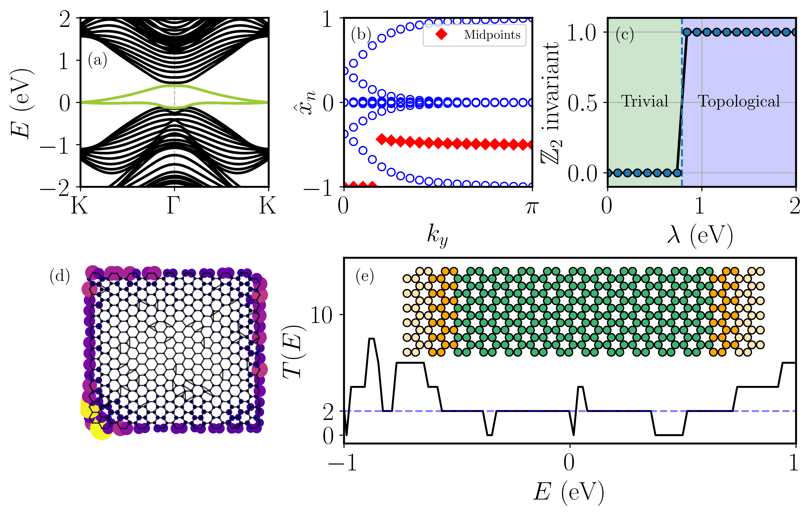

<div align="center">
  
  
  [](https://tightbinder.readthedocs.io/en/latest/?badge=latest)
  [](https://github.com/alejandrojuria/tightbinder/issues)
  [](https://www.gnu.org/licenses/gpl-3.0)
  
  [](https://doi.org/10.21105/joss.05810)

  
  
  
</div>

tightbinder es una biblioteca de Python para cálculos de estructura electrónica basados en la aproximación de Slater-Koster para modelos de tight-binding. Proporciona todas las herramientas necesarias para construir, modificar y caracterizar cualquier material cristalino o desordenado.

La construcción de un modelo de Slater-Koster se basa en la definición de un archivo de configuración, que contiene toda la información necesaria para construir el modelo.
Es decir, se debe especificar por completo la estructura cristalina, es decir, los vectores de Bravais y el motivo, y la estructura electrónica, que comprende los orbitales, las energías en sitio y los saltos entre orbitales. El archivo de configuración caracteriza por completo los modelos de Slater-Koster y constituye el punto de partida para la mayoría de los cálculos realizados con la biblioteca. Alternativamente, también es posible definir modelos personalizados que aún pueden aprovechar las capacidades del paquete. 

Las características de la biblioteca son:
* Construcción de modelos **Slater-Koster** de tight-binding hasta orbitales $d$, con **acoplamiento spin-órbita** intraatómico. 
* Construcción de modelos de Slater-Koster **amorfos**, con saltos modificados en consecuencia (ley de potencia o exponencial) con respecto al modelo cristalino.
* Métodos para **modificar** el sistema según se desee: construcción de superceldas, sistemas finitos, introducción de vacantes o impurezas, amorfización de la red,
  aplicación de campos eléctricos o magnéticos.
* **Caracterización topológica** completa de materiales: evolución de los centros de carga de Wannier, invariante $\mathbb{Z}_2$, curvatura de Berry, número y marcador de Chern, y espectro de entrelazamiento espacial.
* Cálculos de **transporte** en dispositivos de **dos terminales** basados en el formalismo de Landauer-Buttiker (conductancia y transmisión).
* Cálculo de **observables** como la estructura de bandas, valor esperado de los componentes del spin, densidad de estados (ya sea usando funciones de Green o el KPM), densidad de estados local, así como las rutinas de graficación para
  las cantidades correspondientes.
* Modelos **predefinidos** (p. ej., Haldane o BHZ) y capacidad para definir modelos personalizados.
* Módulo de **ajuste** para obtener los parámetros de Slater-Koster de cualquier modelo definido por el usuario a partir de alguna estructura de bandas de entrada.
* Clases adicionales para construir modelos (definir modelo enlace por enlace en lugar de depender del constructor de Slater-Koster, o apilamientos de capas 2D) (en desarrollo).



Para una descripción completa de las capacidades del paquete, remitimos a la [documentación](https://tightbinder.readthedocs.io/en/latest/), donde se pueden encontrar varios ejemplos de uso junto con la referencia completa de la API.


## Instalación

Se recomienda en general el uso de un **entorno virtual** para evitar conflictos entre paquetes.

Para instalar la última versión del paquete, simplemente ejecute:
```bash
pip install tightbinder
```

Alternativamente, puede clonar el repositorio para obtener la versión más actualizada del paquete. 
```
git clone https://github.com/alejandrojuria/tightbinder.git
```

Desde la carpeta raíz del repositorio, instale la biblioteca (lo cual instalará automáticamente las dependencias requeridas):
```
cd {path}/tightbinder
pip install .
```

## Documentación
La documentación se puede acceder [en línea](https://tightbinder.readthedocs.io/en/latest/). Para generarla, debe tener instalados GNU Make y la biblioteca en sí. Los requisitos adicionales para generar la documentación se pueden instalar especificando el calificador docs al instalar tightbinder
```
cd {path}/tightbinder
pip install ".[docs]"
```
Luego, ```cd docs/``` y después, ejecute ```make html``` para generar la documentación. Esta se creará en ```docs/build/html```, y se puede acceder a ella a través de ```index.html```.

## Contribuciones
La biblioteca aún está en desarrollo a medida que se agregan nuevas funcionalidades y optimizaciones. Por lo tanto, cualquier tipo de contribución es bienvenida, desde completar la documentación, corregir errores, agregar nuevas funcionalidades o reportar errores de la biblioteca.
En general, cualquier contribución debe adherirse a las [guías de estilo PEP](https://peps.python.org/pep-0008/). ¡En caso de duda, no dude en contactarnos!
